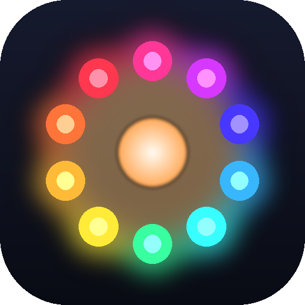

<p align="center"></p>

# Lumora

Musiksynchrone Lichtshows für adressierbare LEDs (WS2812B, SK6812 RGB/RGBW) an WLED-Controllern –
mit 3D-Raummodell, Betrachterposition, Songanalyse, grafischem Timeline-Editor und KI-Unterstützung
über Claude Code.

## Funktionen

**Raum und LEDs**
- Grundriss als 2D-Skizze (Ecken ziehen, einfügen, löschen, Vorlagen) plus Raumhöhe – oder ein Foto /
  einen Bauplan hochladen, Maßstab über zwei Punkte festlegen und die Ecken nachzeichnen.
- LED-Strips als Linien, Bezier-Kurven, Bögen, Kreise und Matrizen; Presets (Deckenumrandung, Wandleiste,
  Eckstreifen, Deckenring, Wand-Matrix, Herz mit Größe und Drehung); Punkte per 3D-Gizmo verschieben (rastet an
  Wänden, Boden, Decke ein),
  ganze Strips verschieben, Punkte per Drag-and-Drop umsortieren.
- 3D-Ansicht perspektivisch oder orthografisch, Achsenkreuz (X/Y/Z) zum Orientieren.
- Betrachter (im Reiter *Raum*) mit Position und Blickrichtung: Effekte können „von links nach rechts durchs
  Blickfeld“ laufen.
- Rückgängig/Wiederholen (Strg+Z / Strg+Y) und ein Versionsverlauf mit Wiederherstellen.
- Neuer Raum leer oder als Kopie eines bestehenden (Raum, Strips, Controller, Kalibrierung, wahlweise mit Shows).

**Hardware**
- WLED-Controller per mDNS finden, Strips Pixelbereichen zuordnen, Testmuster, Live-Ausgabe per DDP (~50 FPS).
- **Bildrate pro Controller:** Ein WLED kann nur so viele Bilder zeigen, wie seine Datenleitungen schaffen
  (WS2812B: ~30 µs pro LED und Pin – 873 LEDs an einem Pin ≈ 32 FPS). Die App liest dazu die LED-Konfiguration
  aus WLED, schickt jedem Controller gleichmäßig getaktet knapp unter seinem Maximum und lässt unveränderte
  Bilder weg (nur Keep-alive). *Geschwindigkeit messen* ermittelt die echte Rate und Paketverluste; die
  Bildrate lässt sich auch von Hand festlegen.
- Statusüberwachung: erreichbar, WLED-Version, gesendete und angezeigte FPS, mögliches Maximum, WLAN-Signal,
  Hinweise (z. B. Strip auf mehrere Datenpins aufteilen, WLAN-Energiesparen aus).
- **Kalibrierung:** Shows rechnen in *wahrgenommener* Helligkeit (0,5 sieht halb so hell aus). Eine Kurve
  (CIE L* oder Gamma) setzt das in PWM um; Mindeststufe, Abschaltschwelle, Weißabgleich, RGBW-Weißmischung und
  räumliches/zeitliches Dithering sorgen dafür, dass dunkle und helle Szenen gut rüberkommen. Ein Assistent zeigt
  Testmuster direkt auf den LEDs (rohe PWM-Stufen, gleichmäßige Stufen, Dunkelstufen, Weiß).
- **Strombudget** pro Controller und Netzteil: Stromschätzung aus den tatsächlichen PWM-Werten, automatische
  Drosselung, Stromverlauf und Warnungen in der Show-Prüfung.
- **Synchronisation:** Sync-Test (Klick auf jeden Beat + LED-Blitz) zum Einstellen von Audio- und Controller-Latenz.

**Musik**
- Songs hochladen (mp3/wav/flac/ogg); Analyse von Tempo, Beats, Takten (3/4 oder 4/4) und Pegeln je
  Frequenzband; Tempo-Korrektur ×2/÷2 und auf 0,1 BPM genau (bleibt bei einer neuen Analyse erhalten).
- **Instrumente:** Der Song wird mit *Demucs* in Schlagzeug, Bass, Gesang, Klavier, Gitarre und den Rest
  getrennt (6 Spuren, ~1,5 Minuten pro Song auf der CPU; ohne das demucs-Paket 4 Spuren mit *Hybrid Demucs*).
  Daraus entstehen Instrumentenspuren: Kick/Snare/Hi-Hat/Crash mit Anschlagstärke (Wirbel und Fills so schnell
  wie gespielt), Bass- und Gesangsnoten, Gesangsphrasen, Drum-Fills, Build-ups, Drops und Passagen ohne
  Schlagzeug, dazu Lautstärkekurven je Instrument. Ohne PyTorch werden Schlagzeug/Bass/Rest geschätzt.
- **Noten mehrstimmig:** Das Notenmodell *Basic Pitch* (Spotify, mitgeliefert, läuft mit onnxruntime) hört alle
  gleichzeitig klingenden Töne von Keys und Synths – Akkorde, die Melodie als oberste Stimme, Arpeggios – und
  verbessert die Tonhöhen von Bass und Gesang. Daraus: Stabs (kurze Akkordschläge), Pads (gehaltene Flächen),
  Arpeggios und die Klanghelligkeit.
- **Harmonie:** Tonart und Akkorde Schlag für Schlag mit ihrer Stufe (I, IV, V, vi …).
- **Songform:** Abschnitte dort, wo sich die Besetzung ändert, bevorzugt nach 4/8/16 Takten – Intro, Strophe,
  Pre-Chorus, Refrain, Break, Build-up, Drop, Bridge, Outro; gleiche Teile bekommen denselben Buchstaben, jeder
  Abschnitt eine Intensität 1–5, der stärkste ist der Höhepunkt (★); dazu Phrasen von 4 oder 8 Takten.
- **Motive:** Riffs und Melodien, die mindestens dreimal wiederkommen, werden erkannt (eigene Spur).
- Songs lassen sich im Reiter *Songs* abspielen (auch langsamer): Ein Positionsanzeiger läuft über Waveform und
  Instrumentenspuren mit Akkorden und Motiven (ganzer Song oder mitlaufender 30-/10-s-Ausschnitt), und Anzeigen
  leuchten auf, sobald Kick, Snare, Bass, Gesang, Melodie, Stab, Fill oder Drop erkannt sind.
- Genauere Beat- und Takterkennung mit dem neuronalen Modell *beat_this*; beide Modelle kommen mit
  `pip install -e ".[ml]"` (PyTorch, ca. 1 GB; Modelldaten werden beim ersten Mal geladen).

**Shows**
- Grafischer Timeline-Editor: Clips ziehen, kürzen, an Beats/Takte einrasten, Mehrfachauswahl, Kopieren/Einfügen,
  Ebenen; Inspektor mit Reglern, Farbwählern, Paletten und den Modi Wert / Audio / LFO / Keyframes; Ziel-Editor.
- 18 Effekte, darunter *Hits* (kurze LED-Segmente leuchten auf Schlägen auf), *Notes* (Noten eines Instruments,
  Position = Tonhöhe, leuchtet so lange wie der Ton), *Sweep* (ein Lichtband läuft durch den ganzen Raum) und
  *Rise* (Build-up bis zum Drop). Effekte lassen sich von jeder Instrumentenspur auslösen (Kick, Snare, Bass,
  Gesang, Lead, Fill, Drop …) und folgen der Anschlagstärke; Auslöser *once* macht aus einem Clip einen
  einmaligen Cue. Muster lassen sich in Metern entlang der Strips legen (Achse `s`).
- **Cues einspielen:** Während der Song läuft, per Klick oder Taste 1–7 einzelne Effekte setzen (Blitz,
  Raumblitz, Ring, Wischer, Funkeln, Rise bis zum nächsten Drop) – rasten auf den nächsten Schlag ein. Eine
  Musik-Zeile in der Timeline zeigt Drops, Build-ups, Fills und Gesang; Clips rasten dort ein.
- **Dynamik:** leise Stellen des Songs dunkeln die ganze Show ab, laute bleiben hell.
- Der Betrachter sieht nicht alle LEDs: Ziele „im Blick“ / „hinter mir“ trennen Detail-Effekte von Raumlicht.
- Eigene Effekte als Python/numpy-Shader (laufen in einem eigenen Prozess), **Looks** als
  wiederverwendbare Clip-Gruppen mit Zeiten in Beats (vier mitgeliefert, eigene aus jeder Auswahl).
- Starter-Show aus Instrumenten, Songform und Raum: jeder sichtbare Strip zeigt ein Instrument (Schlagzeug als
  kleine Treffer, Gesang/Keys und Bass als Noten, Arpeggios als Lauflicht, Stabs als Blitze), Cues auf Drops,
  Build-ups, Fills und Crashes, jedes Motiv mit eigener Geste; gleiche Abschnitte sehen gleich aus, Wiederholungen
  steigern sich, der Höhepunkt ist am hellsten, leise Passagen bleiben dunkel. **Stile** Party / Ruhig / Kino /
  Minimal, **Farbwelten** (automatisch nach Tonart: Moll kühl, Dur warm; oder kühl, warm, Neon, Natur, mono),
  Grundhelligkeit, Stroboskop auf dem Höhepunkt; „Neue Variante würfeln“. Die Prüfung warnt vor zu heller Show,
  hellen leisen Stellen, fehlendem Kontrast und Stillstand.
- 3D-Vorschau mit Bloom und Betrachter-Sicht; alle Bereiche lassen sich an den Trennlinien größer/kleiner ziehen.
- **Export** als FSEQ-v2-Paket für xLights / Falcon Player (kalibrierte Werte, Audio, Kanal-Zuordnung) und
  **Video** der 3D-Vorschau mit Ton (WebM).
- **Handy als Fernbedienung:** QR-Code scannen, dann im WLAN Abspielen/Pause, ±10 s, Helligkeit, Show wechseln
  und Cues live auslösen. Eigener kleiner Server (Port 8010), nur mit dem Code aus dem QR-Code; standardmäßig aus.

**Bedienung**
- Einführung „Erste Schritte“ (Checkliste in der Seitenleiste), Beispielraum ohne Hardware, Hilfe-Symbole (?) an
  allen Fachbegriffen, durchsuchbares Handbuch, Tastenkürzel (Taste „?“), leere Seiten mit nächstem Schritt,
  Fehlermeldungen mit Lösungsvorschlag.
- Einfacher Modus und Expertenmodus (JSON, Shader, Feinabstimmung).
- Oberfläche auf Deutsch und Englisch (nach Browser-Sprache, umschaltbar im Hilfe-Menü).
- Projekte als Datei exportieren und importieren (mit oder ohne Songs), Räume als Kopie anlegen.

**Sicherheit und Datenschutz**
- Warnhinweis zu lichtempfindlicher Epilepsie beim ersten Start; **Blitzbegrenzung** (standardmäßig höchstens drei
  große Blitze pro Sekunde, WCAG 2.3.1) für Vorschau, LEDs und Export; Stroboskope laufen nie schneller.
- Alles läuft lokal. Ein **Diagnosepaket** für Fehlerberichte enthält Versionen, Anzahlen und Logs – ohne Namen,
  IP-/MAC-Adressen, Rechnernamen, Benutzerpfade und E-Mail-Adressen. *Über diese App* zeigt, wann Daten den PC
  verlassen, und die Lizenzen aller Bausteine.

**KI**
- *Show mit KI erstellen*: nutzt dein lokal installiertes **Claude Code** im Hintergrund (`claude -p`) mit deinem
  Claude-Abo – keine API-Kosten. Claude bekommt nur die Werkzeuge dieser App (kein Datei- oder Shell-Zugriff).
  Modell wählbar (Standard: Opus 5.5, braucht Claude Code ≥ 2.1.280 – „Claude Code aktualisieren“ im KI-Dialog);
  lehnt Claude Code das Modell ab, läuft die Generierung mit dessen Standardmodell weiter.

## Voraussetzungen

- Python ≥ 3.12 (getestet mit 3.14; zstd-komprimierter Export braucht 3.14)
- Node.js ≥ 20 (zum Bauen der Oberfläche)
- Optional: [Claude Code](https://claude.com/claude-code), angemeldet mit deinem Claude-Konto, für die eingebaute KI

## Installation und Start

```powershell
.\start.ps1                # richtet beim ersten Start alles ein, öffnet http://127.0.0.1:8000
.\create_shortcut.ps1      # optional: Desktop-Verknüpfung, App läuft im eigenen Fenster
```

Manuell:

```powershell
cd backend
python -m venv .venv
.venv\Scripts\python -m pip install -e ".[dev]"
cd ..\frontend
npm install
npm run build
..\backend\.venv\Scripts\lumora            # Server im Terminal
..\backend\.venv\Scripts\lumora-desktop    # oder als App-Fenster (schließen = beenden)
```

Entwicklung mit Hot-Reload: Backend starten und zusätzlich `npm run dev` in `frontend` (<http://localhost:5173>).

### Umgebungsvariablen

| Variable         | Standard      | Bedeutung |
|------------------|---------------|---------------------------------------------------------------|
| `LUMORA_DATA`    | `./data`      | Projekte, Songs, Shows, Einstellungen |
| `LUMORA_PORT`    | `8000`        | HTTP-Port |
| `LUMORA_HOST`    | `127.0.0.1`   | Bind-Adresse |
| `LUMORA_AUDIO`   | `device`      | `null` = stumme Uhr ohne Soundkarte (Tests, Server) |
| `LUMORA_FPS`     | `50`          | höchste Bildrate für DDP (langsamere Controller bekommen weniger) |
| `LUMORA_STEMS`   | (Einstellung) | Instrumententrennung: `auto`, `demucs6`, `demucs`, `approx` (schnell, ohne Gesang), `off` |

## Erste Schritte mit echten LEDs

1. WLED: LED-Typ, Anzahl und Farbreihenfolge einstellen; *Receive UDP realtime* aktiv lassen (DDP, UDP 4048).
2. App → *Controller*: Gerät suchen oder IP eingeben, Strips zuordnen, mit *Test* Anfang (grün) und Ende (rot)
   prüfen, Strombudget des Netzteils eintragen.
3. *Kalibrierung* im abgedunkelten Raum: Mindeststufe finden, Kurve prüfen, dunkle Stufen und Weißabgleich.
4. *Kalibrierung → Synchronisation*: Sync-Test starten und Audio-Latenz einstellen, bis Klick und Blitz zusammenfallen.
5. Song hochladen, Show erstellen (Starter, Editor oder KI), im Player auf **LIVE** schalten.

Mehr FPS bei langen Strips: In WLED die LEDs auf mehrere Ausgänge (Datenpins) verteilen – die Pins werden
parallel beschrieben, z. B. 2 × 437 statt 1 × 873 LEDs ≈ 50 statt 32 FPS. WLAN-Energiesparen in WLED ausschalten.

Ohne Hardware testen: `backend\.venv\Scripts\lumora-wled-sim --leds 600 --http 8081 [--pins 2]` startet einen
simulierten WLED-Controller (per mDNS auffindbar, empfängt DDP, zeigt wie ein echter höchstens so viele Bilder,
wie seine Pins schaffen; `/sim/stats` meldet empfangene und angezeigte FPS).

## KI

*Shows → Mit KI*: Song wählen, Wunsch beschreiben, *Show generieren*. Der Fortschritt erscheint live; das
Ergebnis ist eine normale, bearbeitbare Show mit Versionsverlauf. Die KI bekommt die Instrumentenspuren (wer trägt
welchen Abschnitt, Drops, Build-ups, Fills, Noten), prüft ihre Show an gerenderten Bildern und darf den Song kurz
im Internet recherchieren.

**Einrichtung (einmalig)** – der KI-Dialog zeigt dieselbe Anleitung, solange Claude Code fehlt:

1. Claude-Konto mit Pro- oder Max-Abo.
2. Claude Code installieren:
   - Windows (PowerShell): `irm https://claude.ai/install.ps1 | iex`
   - macOS/Linux: `curl -fsSL https://claude.ai/install.sh | bash`
   - oder mit Node.js ≥ 18: `npm install -g @anthropic-ai/claude-code`
3. Im Terminal `claude` starten und mit dem Claude-Konto (Abo, nicht Anthropic Console) anmelden, dann `/exit`.
4. `claude --version` prüfen, Lumora neu starten.

Lumora startet Claude Code im Hintergrund (`claude -p`) und gibt ihm über eine lokale Schnittstelle nur die
Werkzeuge der App. Ein gesetztes `ANTHROPIC_API_KEY` wird dabei bewusst ignoriert, damit keine API-Kosten entstehen.

## Show-Format (Kurzfassung)

```json
{
  "name": "Party", "song_id": "…",
  "layers": [
    { "name": "Raum", "clips": [
      { "start": 0, "end": 48, "effect": "noise", "params": { "palette": "ocean", "brightness": 0.08 },
        "target": { "view": "indirect" } } ] },
    { "name": "Drums", "clips": [
      { "start": 16.5, "end": 48, "effect": "hits", "blend": "max",
        "params": { "trigger": "kick", "palette": ["#40c0ff", "#ffffff"], "count": 3, "size": 12, "decay": 0.2 },
        "target": { "tags": ["wall"], "view": "direct" } } ] }
  ]
}
```

Helligkeiten sind wahrgenommen: Grundstimmung 0,03–0,15, Akzente 0,6–1,0, nichts unter 0,03. Lange Strips
hellen den ganzen Raum auf und brauchen weniger. `"dynamics": 0.6` auf der Show dunkelt leise Passagen ab;
Trigger wie `"kick"`, `"vocal"`, `"keys"`, `"chord"`, `"stab"`, `"motif"`, `"drop"` oder `"once"` (einmaliger Cue
zum Clip-Start). Die vollständige Beschreibung liefert `get_show_format`.

## Architektur

```
frontend/  React + Three.js (react-three-fiber)  ──REST/WebSocket──►  backend/ FastAPI (lumora)
backend/lumora/
  model/      Raum, Fixtures, Controller, Kalibrierung, Betrachter, Songs, Shows
  geometry/   Fixture → LED-Positionen, betrachterbezogene Koordinaten
  audio/      Analyse (librosa, beat_this), Instrumententrennung (Demucs) und -spuren, Notenerkennung (Basic
              Pitch), Harmonie, Songform, Motive, Bibliothek, Player, Demo-Songs
  render/     Effekte, Parameter, Shader (+ Worker-Prozess), Looks, Engine, Validierung, Snapshots
  output/     Kalibrierkurve, Ausgabe-Pipeline mit Strombegrenzung, DDP, WLED-API/mDNS, FSEQ-Export
  playback/   Takt-Schleife, Testmuster, Sync-Test
  storage/    Projekte, Shows, Looks, Versionsverlauf, Export/Import
  ai_agent    Claude-Code-Anbindung      mcp_server   Werkzeuge für Claude    desktop   App-Fenster
  remote      Handy-Fernbedienung        diagnostics  Diagnosepaket
frontend/src/i18n  Englische Texte (en.ts), scripts/extract-strings.mjs listet fehlende Übersetzungen
```

Eine einzige Render-Engine erzeugt Vorschau, Live-Ausgabe, Export und KI-Snapshots – alle zeigen dasselbe.

## Tests und Qualität

```powershell
cd backend
.venv\Scripts\python -m pytest            # ~150 Unit- und Integrationstests
.venv\Scripts\python -m pytest -m ml      # mit den neuronalen Modellen (Demucs)
.venv\Scripts\python -m pytest -m ui      # Browser-Tests deutsch und englisch (gebautes Frontend + Playwright)
.venv\Scripts\python -m ruff check lumora tests
cd ..\frontend; npm run lint; npm run typecheck
```

GitHub Actions (`.github/workflows/ci.yml`) führt Backend-Tests (Python 3.12/3.14), Lint, Typecheck, Build und den
Browser-Test aus.

## Hinweise

- Shader laufen in einem eigenen Prozess und mit eingeschränktem Python; das schützt vor Hängern und Versehen,
  ist aber keine Sicherheitsgrenze gegen absichtlich bösartigen Code.
- Abschnittsnamen sind heuristisch; die Ähnlichkeits-Labels (A, B, C …) zeigen, welche Teile gleich klingen.
- Die Schnittstelle für Claude Code ist nur lokal erreichbar (DNS-Rebinding-Schutz für localhost).

## Lizenz

[MIT](LICENSE). Das mitgelieferte Notenmodell *Basic Pitch* steht unter Apache-2.0
(`backend/lumora/audio/models/NOTICE-basic-pitch`); die Lizenzen aller Bausteine zeigt *Über diese App*.
